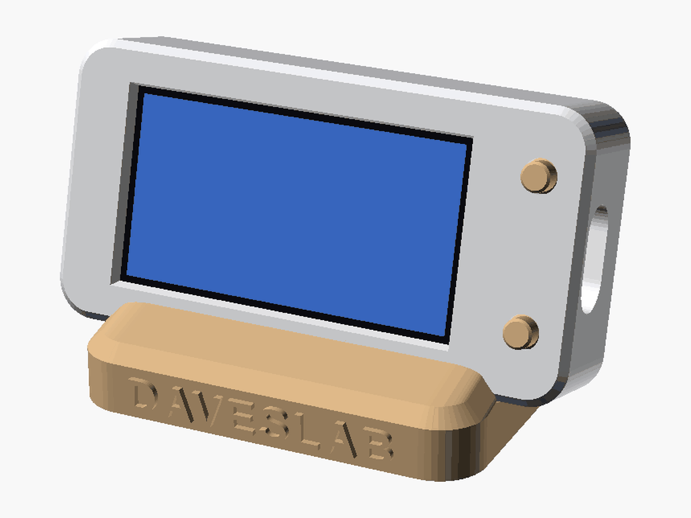
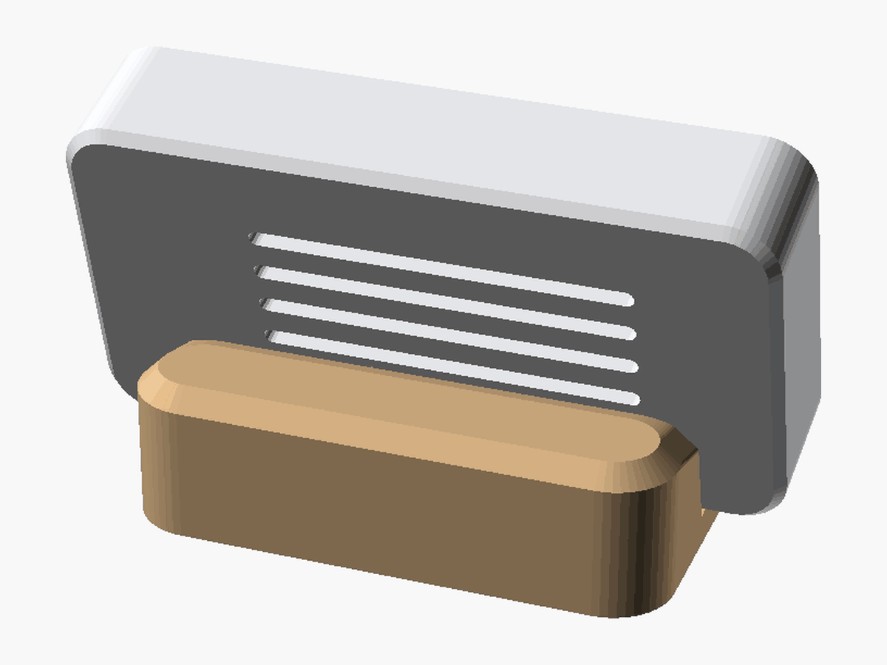
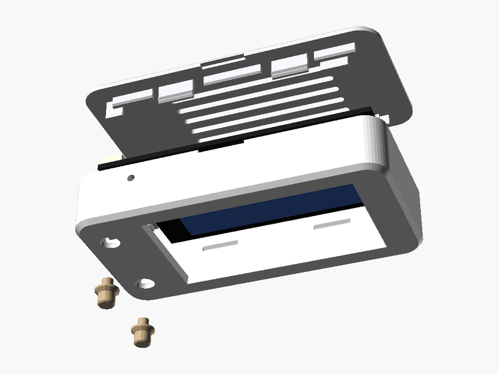
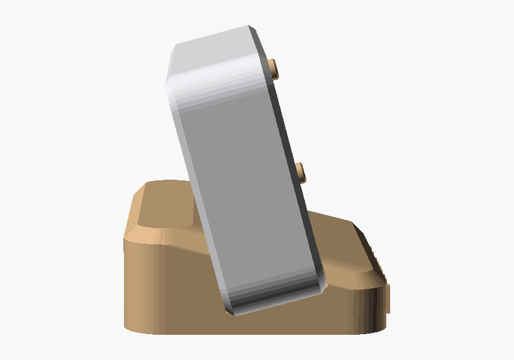
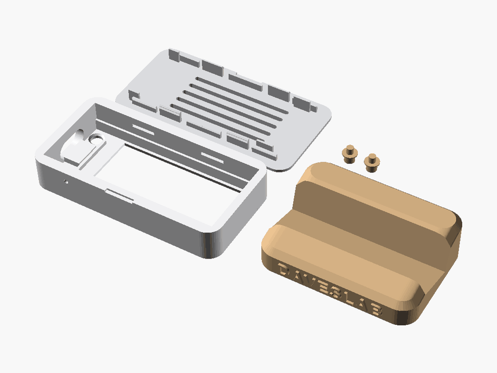
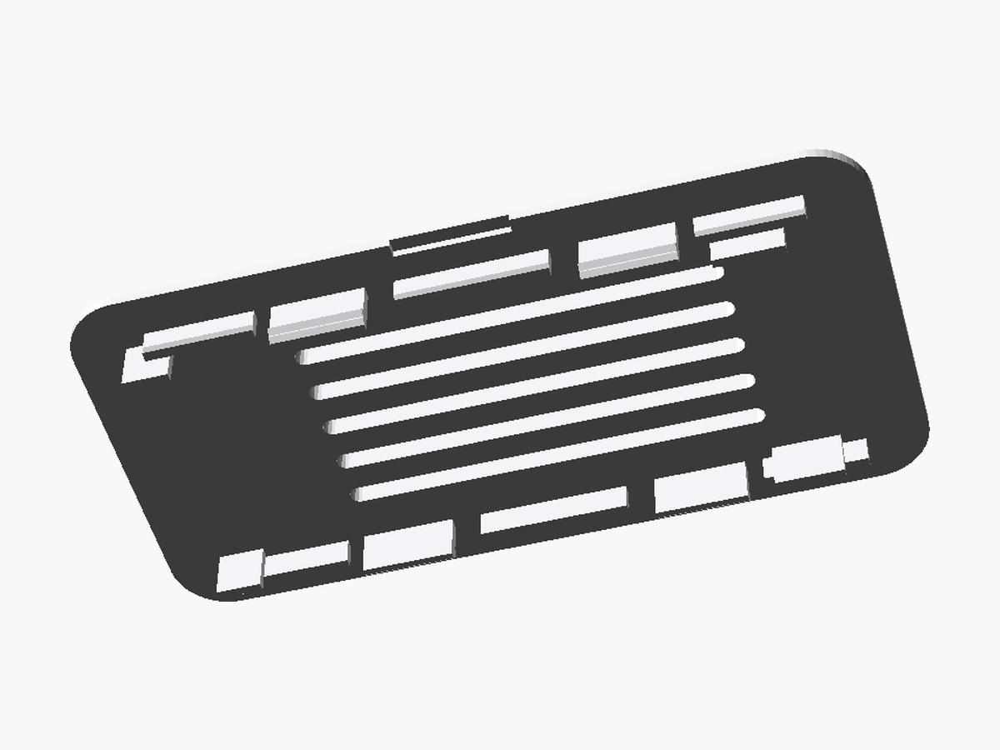
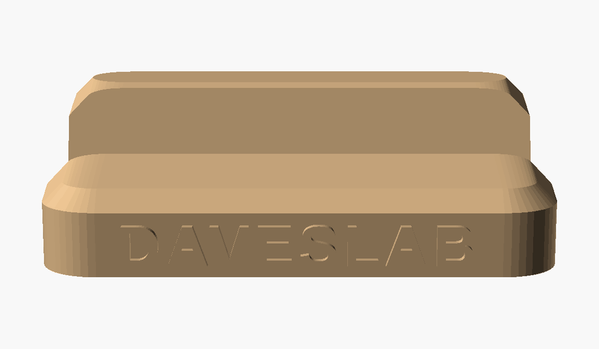

# 🖨️ Gehäuse für die Wetterstation

Schlankes Gehäuse zum 3D-Drucken für das **LILYGO T-Display-S3** (ohne Touch): quer, leicht nach hinten geneigt auf einem Standfuß,
Display links, die zwei Tasten rechts daneben, USB-C rechts an der Seite. Kein Akku. Vorn am Fuß steht erhaben **DAVESLAB** – zum Ausmalen mit einem schwarzen Edding.



| | |
|---|---|
|  |  |
|  |  |
|  |  |

## Version 2 – nach dem ersten Probedruck

| Problem in Version 1 | Geändert |
|---|---|
| Tastenstößel gingen zu schwer in die Löcher | Spiel 0,3 statt 0,15 mm (`spiel_taste`) |
| Tasten standen nur 0,4 mm vor, schlecht zu erreichen | Kappe steht jetzt **1,8 mm** vor (`taste_vor`), der Stößel ist in seiner echten Ruhelage gezeichnet: Bund liegt im Sitz, 0,1 mm Luft zur Taste auf dem Board – kein Klappern, keine dauerhaft gedrückte Taste |
| Zwei Zapfen sollten durch Löcher am Display-Ende der Platine – dort liegt aber das Display, das Board ging nicht rein | Zapfen, Stützen und der Glasanschlag an diesem Ende sind weg. Das Board liegt mit dem Glas auf der Frontplatte, wird von der Hohlraumwand geführt und von vier Rippen im Deckel angedrückt |
| Deckel rastete ein, rutschte aber hin und her | Nuten so lang wie die Laschen (vorher je Seite 1 mm Luft, `spiel_nut`), dazu Zentrierleisten an beiden Längsseiten (außerhalb der Platine, `zentrier_h`) |
| – | Schriftzug **DAVESLAB** erhaben vorn am Standfuß, 0,8 mm hoch (`schrift`, `schrift_relief`) |

Am Rechner geprüft: Alle Teile sind geschlossene Körper, und Schale, Deckel, Tasten und das vereinfachte Board überschneiden sich nirgends.

**Außenmaße:** 67,7 × 35 × 14,5 mm (ohne Fuß) · Fuß 52 × 38 mm, 15° Neigung

## Teile

| Datei | Teil | So aufs Druckbett | Anzahl |
|---|---|---|---|
| `stl/front.stl` | Schale mit Displayfenster, Tastenlöchern, USB-C-Öffnung | Front nach unten (liegt schon richtig) | 1 |
| `stl/deckel.stl` | Rückdeckel mit 4 Schnapplaschen und Lüftungsschlitzen | Außenseite nach unten (liegt schon richtig) | 1 |
| `stl/tasten.stl` | Tastenstößel für **IO0** (oben) und **IO14** (unten) | Kappe nach unten (liegen schon richtig) | 2 in einer Datei |
| `stl/staender.stl` | Standfuß (Keil, Gerät steckt nur drin) mit Schriftzug vorn | Unterseite nach unten | 1 |

Alle Teile gehen **ohne Stützstruktur** (alle Überhänge 45° oder flacher, das USB-Loch ist ein Langloch mit runden Enden).
Gedacht für FDM, Düse 0,4 mm, PLA, Schicht 0,2 mm (für die Front schöner: 0,12–0,16 mm), Infill 15–20 %.
Hübsch: Schale und Deckel in Weiß oder Schwarz, Tasten und Fuß in Holz-PLA. Den Schriftzug am Fuß mit einem schwarzen Edding ausmalen
(die Buchstaben stehen 0,8 mm vor).

## Zusammenbau

1. Die zwei Tastenstößel von innen in die Löcher der Front stecken (der Kegel liegt im Sitz, die Kappe schaut vorn 1,8 mm raus).
2. Das Board mit dem Display nach unten in die Schale legen, USB-C zur Öffnung: das Display liegt hinter dem Fenster,
   die USB-Buchse liegt auf einem Klotz (trägt beim Einstecken). Am anderen Ende ist nichts im Weg.
3. Deckel aufdrücken, bis er an allen vier Laschen einrastet. Vier Rippen an den Platinenrändern drücken das Board an.
4. In den Fuß stecken, fertig.

**Öffnen:** unten in der Mitte ist eine kleine Kerbe in der Trennfuge (im Fuß verborgen) – mit Münze oder Fingernagel aufhebeln.
**Reset:** kleines Loch unten (Büroklammer), steckt im Fuß – meist reicht es, das Kabel kurz abzuziehen.
**Kabel:** Die Buchse sitzt an der rechten Seite. Ein USB-C-Winkelstecker sieht am saubersten aus;
gerade Stecker passen bis 12,8 × 7 mm Steckerkörper.

## Anpassen (OpenSCAD)

Alles steht in `wetterstation_gehaeuse.scad`, die Werte oben sind Parameter (auch im Customizer von OpenSCAD):

- `spiel`, `spiel_deckel`, `spiel_taste`, `spiel_nut`, `spiel_fuss` – Toleranzen, falls dein Drucker enger oder weiter druckt
  (Deckel zu fest → `spiel_deckel` 0,2; Tasten immer noch zu schwer → `spiel_taste` 0,35; Fuß zu stramm → `spiel_fuss` 0,35)
- `taste_vor` – wie weit die Tastenkappen vorstehen
- `zentrier_h` – Höhe der Zentrierleisten am Deckel
- `schrift`, `schrift_groesse`, `schrift_relief` – Schriftzug am Fuß (`""` = keiner)
- `fuss_neigung`, `fuss_hoehe`, `fuss_vorn` – Winkel und Form des Fußes
- `rueckraum` – mehr Platz hinten, z. B. `6` für eingelötete Stiftleisten
- `eck_radius`, `fase`, `hoehe`, `rand_tasten`, `rand_gegen` – Look und Größe
- `reset_loch`, `lueftung` – an/aus

STL neu erzeugen (OpenSCAD 2021.01 oder neuer):

```bash
openscad -D 'teil="front"' -o stl/front.stl wetterstation_gehaeuse.scad
openscad -D 'teil="deckel"' -o stl/deckel.stl wetterstation_gehaeuse.scad
openscad -D 'teil="tasten"' -o stl/tasten.stl wetterstation_gehaeuse.scad
openscad -D 'teil="staender"' -o stl/staender.stl wetterstation_gehaeuse.scad
```

Ansichten: `teil="alles"` (im Fuß), `"explosion"`, `"druckplatte"`, `"platine"` (vereinfachtes Board).

## Board-Maße

Aus LILYGOs eigenem 3D-Modell vermessen ([Xinyuan-LilyGO/T-Display-S3](https://github.com/Xinyuan-LilyGO/T-Display-S3), Ordner `dimensions/`),
und das Gehäuse wurde gegen dieses Modell auf Kollisionen geprüft:

| | |
|---|---|
| Platine | 60,8 × 25,5 × 1,2 mm (die zwei Löcher im Modell am Ende gegenüber USB sind am echten Board vom Display verdeckt – nicht benutzt) |
| Display-Glas | 49,9 × 26,0 × 1,5 mm, vorderste Fläche 6,4 mm vor der Platinenoberseite |
| sichtbare Fläche | 42,7 × 22,7 mm |
| Bauteile hinten | bis 3,5 mm hoch (JST-Stecker) |
| USB-C | auf der Displayseite, mittig, ragt 1,2 mm über die Platine |
| Tasten IO0 / IO14 | vorn neben der USB-Buchse (drücken von vorn, nicht seitlich), Kappe 2,7 mm hinter der Glasfläche |
| RST | seitlich, 10 mm vom USB-Ende |

Version 1 wurde gedruckt, Version 2 behebt die Punkte oben und ist noch nicht gedruckt. Wenn etwas klemmt: Toleranzen oben anpassen.
